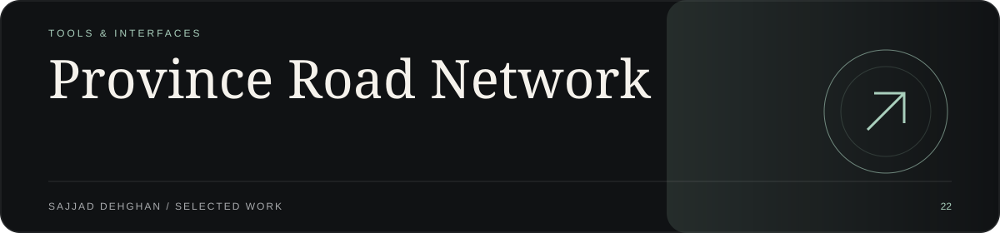
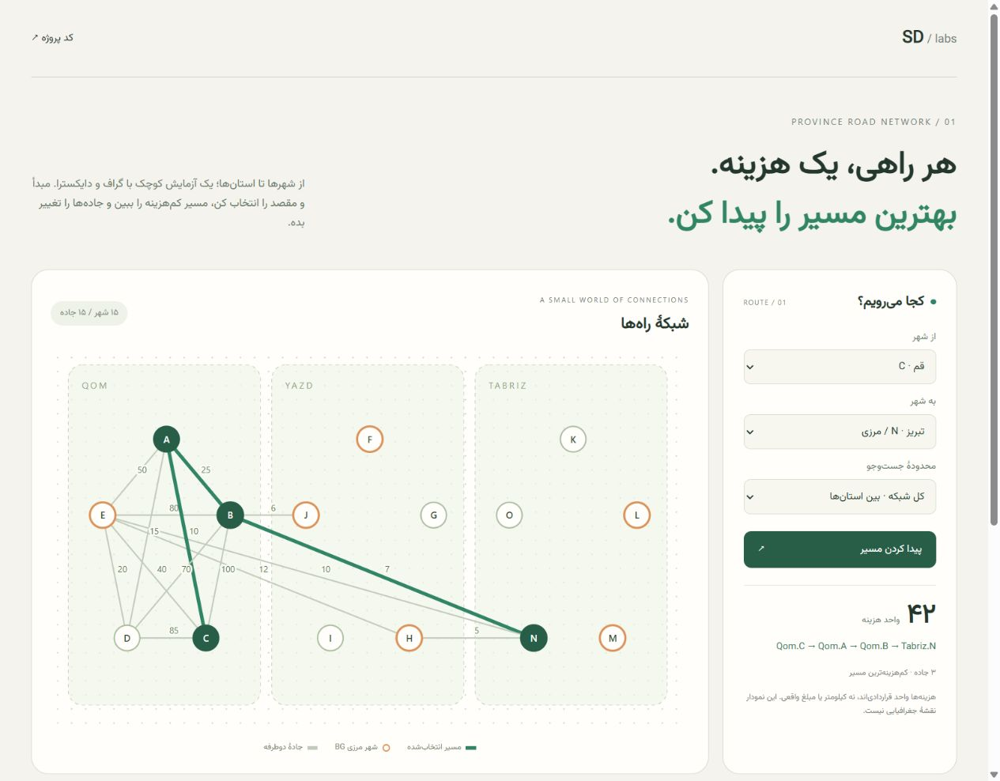
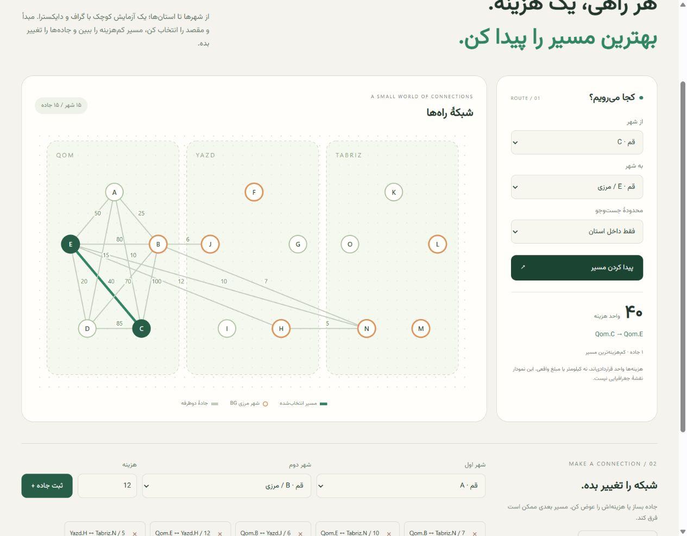
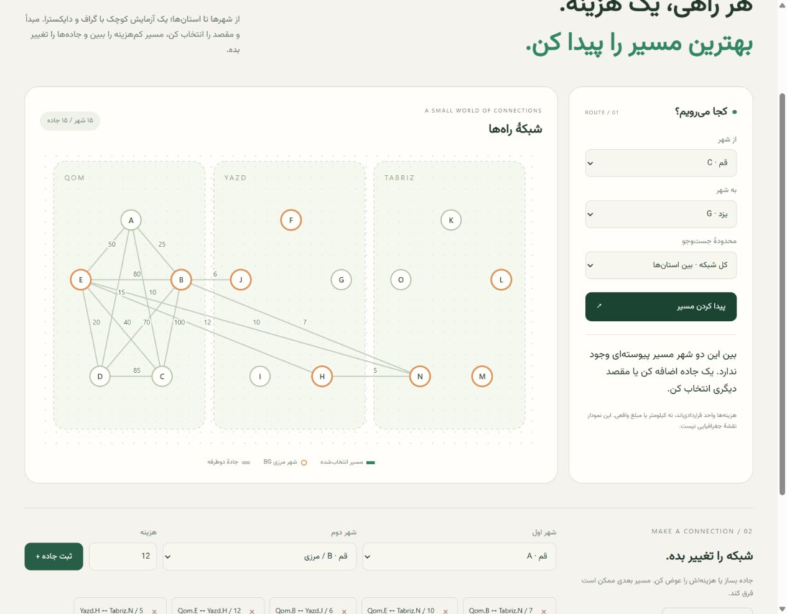
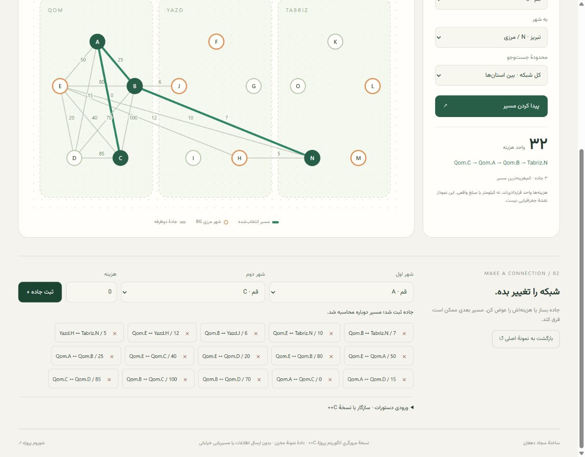
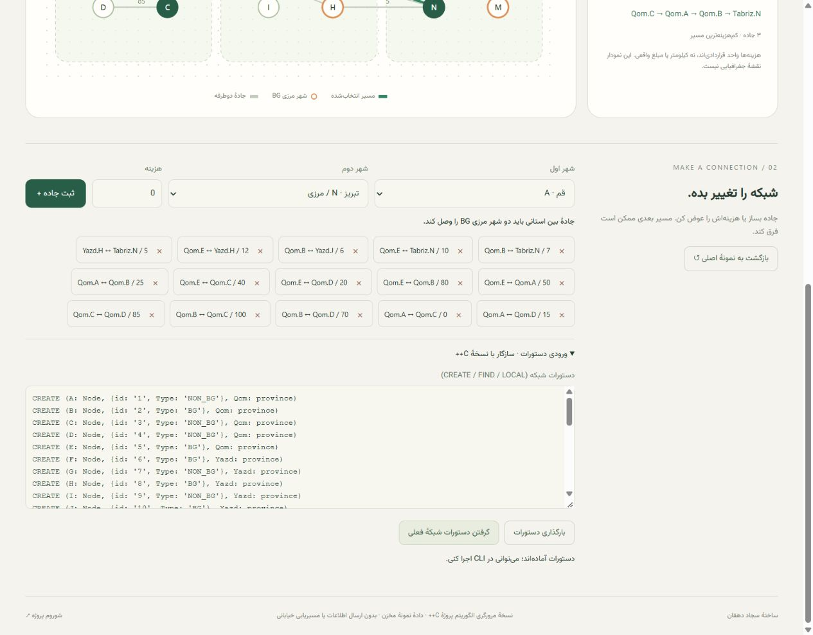

<p align="center"></p>

<h1 align="center">Province Road Network</h1>
<p align="center">A small world of connections.<br>Safe C++ routing. A minimal Persian web explorer.</p>
<p align="center"><a href="https://sajjad-dehghan.ir/demos/province-road-network/"><strong>Try the interactive explorer ↗</strong></a> · <a href="https://sajjad-dehghan.ir/fa/projects/province-road-network">Project showroom ↗</a></p>



## Explore the network

Choose two cities, highlight the cheapest route, switch to province-only routing, change a road's cost, add/remove roads, or import/export the original command format. The browser and native CLI use the same sample network and route semantics.

- Persian RTL interface with a locally bundled font, responsive layout and mobile graph zoom.
- An abstract SVG graph, not a geographical map. Roads are undirected.
- The original sample has **15 cities, 15 roads and three provinces**: Qom, Yazd and Tabriz.
- The sample query `FIND Qom.C->Tabriz.N` costs **42**, following `Qom.C → Qom.A → Qom.B → Tabriz.N`.
- `LOCAL Qom.C->Qom.E` stays within Qom and costs **40**.
- Unreachable destinations have an explicit empty result; zero-cost roads remain valid.
- No analytics, account, street-routing service, remote API or persistent user data. Changes live in page memory and reset on reload.

**Edition boundary:** the web UI computes routes using a JavaScript port in `web/engine.mjs`; it does not run a hidden C++ server or WebAssembly. Exported commands can be run by the C++ CLI. Native/browser cost parity is tested for every original city pair and a seeded network. Sample road costs are arbitrary units, not real travel distances, prices or navigation advice.

## Visual tour

All images below are actual captures of the running browser edition with repository sample/test data. No generated UI mockups.

| Local route | No connection |
| --- | --- |
|  |  |




<details>
<summary>Mobile layout</summary>


The graph has an opt-in zoom control and internal scrolling; the page itself does not overflow horizontally.
</details>

## Run locally

The browser edition needs **Node.js 22+**, no npm dependencies:

```sh
node scripts/serve.mjs
```

Open `http://localhost:4322/`. Optional port: `PORT=4323 node scripts/serve.mjs` (PowerShell: `$env:PORT=4323`).

### Native C++17 CLI

Portable standard-library-only build with CMake:

```sh
cmake -S . -B build
cmake --build build
ctest --test-dir build --output-on-failure
./build/app input/input.txt
```

For multi-configuration Visual Studio generators, executables are in `build/Debug/` and use `ctest --test-dir build -C Debug`. Alternatively, on Windows with Visual Studio C++ Build Tools + Windows SDK:

```powershell
powershell -ExecutionPolicy Bypass -File scripts/build-windows.ps1
./build/app.exe input/input.txt
node --test tests/*.test.mjs
```

GCC/Clang users can use `make` and `make test`. The Makefile uses the real lowercase source filenames and has no unrelated SFML dependency.

### Command format

```text
CREATE (A: Node, {id: '1', Type: 'BG'}, Qom: province)
CREATE (B: Node, {id: '2', Type: 'BG'}, Qom: province)
CREATE (A.Qom) - [:ROAD {cost:0}] -> (B.Qom)
FIND Qom.A->Qom.B
LOCAL Qom.A->Qom.B
```

City commands use `City.Province` in roads and `Province.City` in queries, matching the historical format. ASCII hyphens and the sample en dashes are accepted. Blank/comment lines and the old `-1` separator are ignored.

- Add cities before roads. Names use ASCII letters/underscore followed by letters, digits, underscores or hyphens.
- City IDs are positive signed 32-bit integers, unique **within a province**. Province-qualified names identify nodes.
- Cross-province roads require both endpoints to be `BG`.
- Re-adding a road updates its cost in both directions.
- Negative costs, malformed input, unknown endpoints, duplicate cities/IDs and self-loops are rejected.
- `FIND` searches the complete graph; `LOCAL` restricts roads to the source province and requires same-province endpoints.
- CLI costs use signed 64-bit integers below `INT64_MAX`. Overflowing sums are not evaluated; `INT64_MAX` is the unreachable sentinel.
- Browser bounds: 500 cities, 10,000 roads, 250,000 input characters, costs from 0 through 1,000,000,000. These limits keep integer arithmetic exact and bound UI work.

## What was fixed

The old index-header adjacency matrices and destructive all-pairs updates were replaced with dynamic adjacency lists and query-local Dijkstra state. This removes out-of-bounds access, uninitialized counters/route endpoints, leaked raw matrices, variable-length arrays, missing return values and confusion between zero-cost/unreachable edges.

Routes reconstruct their actual city sequence, choose among **all** border gateways, and can traverse local roads inside intermediate provinces. Local routing now prints a result. Road weights never change when searching. The linked queue is now an RAII-backed compatibility wrapper, and the build works with standard C++17 headers.

**Migration:** province/city count prompts and matrix-printing internals are retired. Feed `input/input.txt` directly as commands instead; it no longer needs an interactive count/terminator wrapper. Historical documentation is retained in [docs/legacy-readme.md](docs/legacy-readme.md), not presented as current behavior.

## Regression checks

```sh
node --test tests/*.test.mjs
```

Build the native executable first. Tests cover every **225** original city-pair costs, **324** seeded-network city-pair costs against native C++ and independent Floyd–Warshall, disconnected/self routes, zero and negative costs, multiple gateways, repeated queries, local-only routing, duplicate/unknown identities, malformed commands and export/import round trips. Native regression also covers a 100-city chain and 64-bit overflow. CI builds on Linux with AddressSanitizer/UndefinedBehaviorSanitizer and runs both suites.

Local verification (2026-10-10): native MSVC build, CMake/CTest Debug, six Node.js tests, 549 native/browser pair comparisons, browser desktop/mobile interactions and a Release AddressSanitizer run passed. Screenshots were saved from the running frontend. CI results remain separate from these local checks.

## Source map

- `include/Map.hpp`, `src/Map.cpp`: validated cities/roads and command parsing.
- `include/GPS.hpp`, `src/GPS.cpp`: safe Dijkstra and route reconstruction.
- `src/app.cpp`, `src/main.cpp`: file/stdin CLI and line-numbered diagnostics.
- `web/`: dependency-free browser explorer and algorithm port.
- `tests/`: native and JavaScript regression/parity suites.
- `docs/showroom/`: actual interface captures and repository banner.

## Credits

The bundled [Vazirmatn font](https://github.com/rastikerdar/vazirmatn) by the Vazirmatn Project Authors is distributed under SIL OFL 1.1; see [web/OFL.txt](web/OFL.txt). Original project authorship/history is preserved in Git. This update does not relicense the original code.
